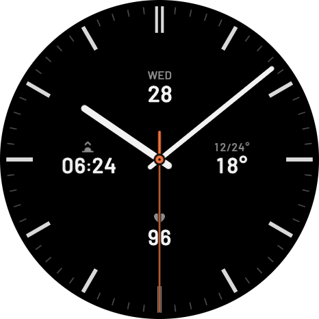

# COROS Watch Faces

Custom watch faces for COROS watches, built with CorosLink Watch Face Studio.

| Face | Style | Built for | Status |
|---|---|---|---|
| [Analog 4-widget](analog-4-widget/) | Analog with date, weather, a switchable metric and sunrise/sunset | PACE 4 Pro | Running on a PACE 4 Pro |

Each folder holds a face's art, fonts and build steps. There are no ready-to-install files, so you build a face in CorosLink Watch Face Studio.

Licensed under [MIT](LICENSE), except for the bundled fonts, which keep their own license. This is an independent project, not affiliated with or endorsed by COROS.
