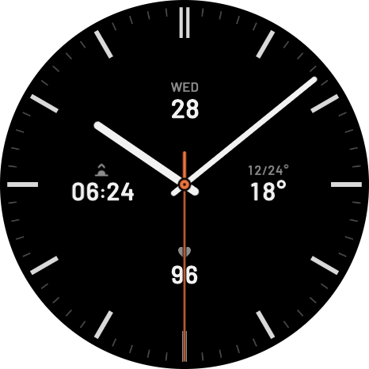
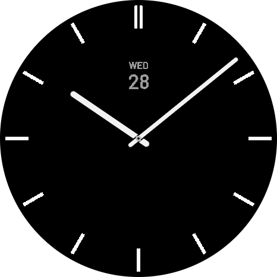

# Analog 4-widget

An analog face for the COROS PACE 4 Pro (466 x 466 AMOLED), with four widgets and a matching always-on display.

| Current display | Always-on display |
|---|---|
|  |  |

These are Studio renders at 466 x 466 with sample data.

## Layout

| Position | Top | Bottom |
|---|---|---|
| 12 o'clock | Weekday | Day of the month |
| 3 o'clock | Low/high temperature | Current temperature |
| 6 o'clock | Metric icon | Metric value: heart rate (default), steps, calories, battery or elevation, chosen on the watch |
| 9 o'clock | Sunrise or sunset icon | Time of the sunrise or sunset |

The always-on display shows the 12 hour ticks in white, filled hour and minute hands, and the date in gray. It has no second hand or other widgets.

## Status

**Confirmed on a PACE 4 Pro:** the face installs and runs, and the always-on display shows the ticks, filled hands and date.

**Checked in Studio's preview only:**
- All five 6 o'clock metrics, and battery at 0, 50 and 100%.
- Negative and three-digit temperatures.
- No clipping at the round edge, and the widgets don't overlap.

## Known limits

- **Always-on movement:** the whole face shifts around in always-on. This is probably the watch's burn-in protection, but COROS hasn't confirmed that, and the face can't control it.
- **Sunrise/sunset format:** it showed 24-hour time when tested. The face has no format setting, and it hasn't been tested with the watch set to 12-hour. The field has no AM/PM marker.
- **Sunset icon:** it's installed but hasn't been seen, even in preview.
- **Weekday language:** the always-on weekday is a set of English images. Other watch languages haven't been checked.
- **Battery icon:** it's static and doesn't show charge level.
- **Hands over widgets:** the hands pass over the widgets, and around 12:00 they cover the date.
- **Low/high temperature:** the run starts from a fixed left position, so it's only centered for values like `41/67°`. Wider values extend to the right without clipping.
- **Negative elevation:** `-120` previews as `120`. This hasn't been checked on a watch.

## Other COROS watches

Only the PACE 4 Pro has been built and tested. CorosLink 0.1.71 lists these watches, and none of the others have been tried:

| Watches | Screen | Screen size | What to expect |
|---|---|---|---|
| **PACE 4 Pro** | AMOLED | 466 | Done |
| PACE 4 | AMOLED | 390 | Should scale from the current art. The always-on tick and date edits need checking. |
| PACE Pro | AMOLED | 416 | Same as PACE 4 |
| NOMAD, APEX 4, APEX 2 Pro | MIP | 260 | Probably needs simplified art |
| VERTIX 2, VERTIX 2S | MIP | 280 | Probably needs simplified art |
| PACE 3, PACE 2, APEX 2, APEX Pro, VERTIX | MIP | 240 | Probably needs simplified art; hardest to fit |

The art is drawn at 800 x 800 and scaled down. At 240 px, the 30 px labels become about 9 px and the icons about 10 px, which is probably too small to read. Studio treats MIP watches differently too: the Current display stays on and the separate always-on design isn't used.

## Files

| Folder | Contents |
|---|---|
| `dial/` | `dial_current.png` (Current dial) and `aod_ticks.png` (always-on ticks) |
| `hands/` | Hour, minute and second hands, center cap, and the always-on center cap |
| `icons/` | Metric and sunrise/sunset icons. `battery_69x54.png` is `battery.png` on the larger canvas that Studio's battery slot needs. |
| `aod_date/` | Pre-rendered always-on date images, in #9A9A9A |
| `font/` | Barlow Medium and SemiBold |
| `preview/` | Studio renders |
| `tools/` | `make_aod_ticks.py`, which builds `aod_ticks.png` from the dial |

To rebuild the face, see [BUILD.md](BUILD.md).

## License

[MIT](../LICENSE), except the Barlow fonts, which are under the [SIL Open Font License](font/OFL.txt).
