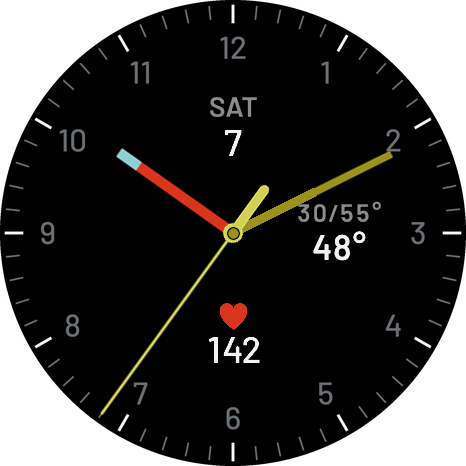
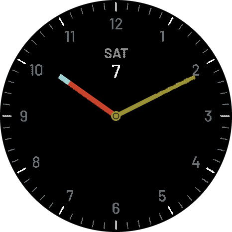
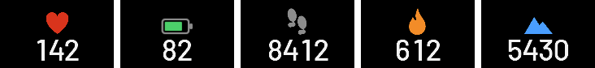

# Braun Analog 3-widget

A functionalist analog face for the COROS PACE 4 Pro (466 x 466 AMOLED), in the style of the Braun clocks Dietrich Lubs and Dieter Rams designed in the 1970s and 80s: plain sans-serif numerals, a fine tick ring, and color used only to tell the hands apart. It has three widgets and a matching always-on display.

| Current display | Always-on display |
|---|---|
|  |  |

The 6 o'clock slot, one image per metric:

These previews are composed from the exported watch images at 466 x 466, with sample data.

## Layout

| Position | Top | Bottom |
|---|---|---|
| 12 o'clock | Weekday | Day of the month |
| 3 o'clock | Low/high temperature | Current temperature |
| 6 o'clock | Metric icon | Metric value: heart rate (default), battery, steps, calories or elevation, chosen on the watch |

**Hands:** red hour hand with a pale blue tip, olive minute hand, and a yellow second hand with a counterweight and a hub that rings the olive center cap.

**Icons:** each metric has its own color: heart rate red, steps gray, calories orange, elevation blue. The battery icon shows the charge level: green at 50% and above or while charging, orange at 30–40%, red at 10–20%, and an empty outline at 0%.

**Always-on display:** the same dial, the hour and minute hands, and the date. It has no second hand, temperature or metric, and the hub takes the minute hand's olive.

## Status

**Confirmed on a PACE 4 Pro:** the face installs and runs.

**Checked against the exported files:** the compiled images were placed at their config positions and measured against the design at 466 x 466. That covered all five 6 o'clock metrics, both displays, °F and °C, and extreme values (−21°, −25/100°, WED 18). Every element landed within 1–2 px of the design.

## Known limits

- **Number spacing:** the watch gives every digit the same width, so values with a 1 in them (like `612`) look a little loose.
- **No separators:** the watch has no comma or % characters, so values read `8412` and `82`.
- **Low/high temperature:** the run starts from a fixed left position, so it's centered for values like `30/55°`. Wide ranges like `-25/100°` extend toward the 3.
- **Hands over widgets:** the hands pass over the widgets, as on the original clocks.
- **Always-on rendering:** CorosLink dims the always-on images by about 15% and gives them hard edges. The whole face also shifts around in always-on, which is probably the watch's burn-in protection.
- **Weekday language:** only English has been checked.
- **Temperature units:** the face shows a plain `°` and follows the watch's unit setting.

## Other COROS watches

Only the PACE 4 Pro has been built and tested. The art is drawn at 800 x 800 and scaled down, so the other AMOLED watches (PACE 4 at 390, PACE Pro at 416) should work from the same files. The MIP watches (240–280) would probably need simplified art. See [Analog 4-widget](../analog-4-widget/README.md#other-coros-watches) for the full list.

## Files

| Folder | Contents |
|---|---|
| `dial/` | `dial_current.png` (Current dial) and `dial_aod.png` (always-on dial, on transparent) |
| `hands/` | Hour, minute and second hands, the center cap, and the always-on cap with its olive hub |
| `icons/` | Metric icons (96 px, placed at 64) and `battery/00–11.png`, the 12 battery states |
| `digits/` | Barlow Medium digits `0–9`, white, used for the day and the 6 o'clock value |
| `font/` | Barlow Medium and SemiBold |
| `preview/` | Previews composed from the exported watch images |
| `tools/` | `spec.py` (every color, size and position) and `gen_assets.py`, which rebuilds the dial, hands, icons and battery images from it |

To rebuild the face, see [BUILD.md](BUILD.md).

## License

[MIT](../LICENSE), except the Barlow fonts, which are under the [SIL Open Font License](font/OFL.txt). The design is inspired by Braun's clocks; this project is not affiliated with or endorsed by Braun or COROS.
